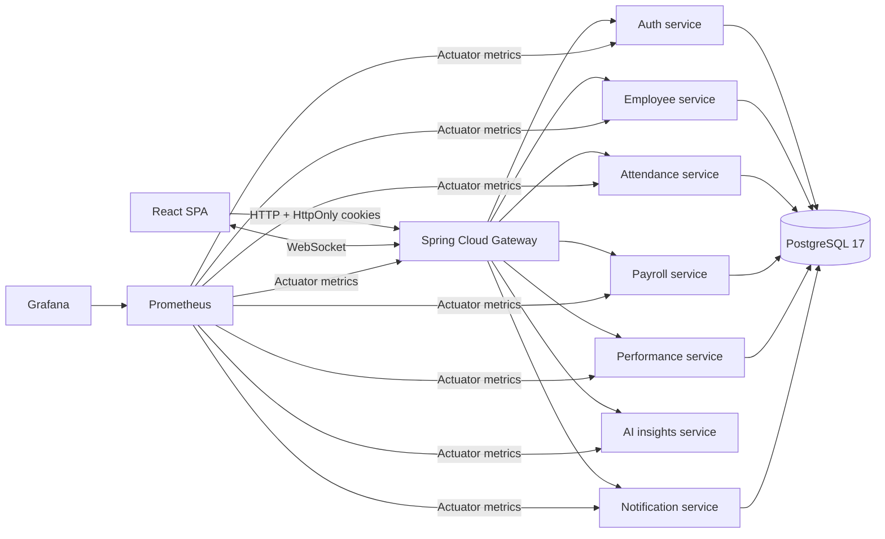
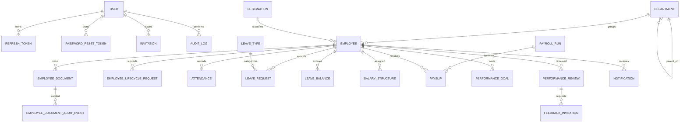

# NexusHR architecture

## Runtime shape

NexusHR is a collection of separately deployable Spring Boot services with a React SPA. The API gateway is the browser-facing API boundary. It routes requests, applies configured CORS policy, forwards the HttpOnly access cookie as a bearer token to downstream services, and proxies authenticated notification WebSocket traffic. Each domain service validates JWTs and enforces its own role/resource access rules; the gateway is not the only authorization boundary.

The database is PostgreSQL 17. Services use separate schemas and Flyway migrations to keep domain persistence isolated while sharing a local PostgreSQL instance. The root Maven build packages services independently. Redis is included in Compose and Kubernetes as infrastructure for future cache/session use; the current request path does not depend on it.

## Service boundaries and API families

| Service | API root | Main responsibilities |
|---|---|---|
| Auth | `/api/auth` | Bootstrap admin, invitations, registration, login, refresh, logout, password reset, current user |
| Employee | `/api/employees` | Directory, employee profile, lifecycle approvals, organization/workforce summary, owner-or-HR document upload/list/download |
| Attendance | `/api` | Attendance entries, leave types/requests/balances, approvals, holidays, lateness/overtime reporting, simulated biometric check-in |
| Payroll | `/api/payroll` | Salary structures, payroll processing/runs, maker-checker approval, payslips, XLSX/CSV/PDF exports |
| Performance | `/api/performance` | Goals, review cycles, self/manager reviews, invited 360 feedback |
| AI insights | `/api/insights` | Explainable workforce indicators from supplied or synthetic metrics |
| Notifications | `/api/notifications` | In-app notifications and authenticated WebSocket updates |

Exact operations and request/response schemas are in each service's generated OpenAPI definition. Compose publishes service ports for local Swagger UI; production Kubernetes services remain internal, and access should be provided through a secured ingress or port-forward.

## Data model overview

The ER view is conceptual: the services own separate schemas, so cross-service references are identifiers and are not database-level foreign keys. Each service migration is authoritative for exact columns and constraints.

Auth owns user identities, roles, invitation state, hashed refresh/reset tokens, rate-limit buckets, and auth audit events. Password reset requests return the same response for known and unknown accounts; reset tokens are single-use, time-limited, stored only as hashes, and successful resets revoke active refresh sessions. Email delivery is queued after transaction commit through the configured SMTP provider; delivery failures are logged and audited. Compose enables local Mailpit for exercising the flow without paid services. Requests are throttled to three per normalized email per hour. Employee owns department/designation hierarchy, employee records, document metadata, and document access audit records. Document bytes use a private local volume in Compose and private S3 with server-side encryption in Kubernetes. Access is limited to the document owner and HR roles; managers do not receive access by default. Attendance owns punches, leave configuration/requests/balances, and holidays. Payroll owns salary structures, runs, and payslips. Performance owns goals, reviews, and feedback invitations. Notifications own persisted notifications and an email-delivery outbox. Attendance, employee, and payroll schemas each also own a producer-side notification outbox. The AI service keeps workforce scores deterministic and supports optional Spring AI recommendation generation with a deterministic fallback. The provider call is server-side, uses a configurable base URL/model and bounded HTTP timeouts, excludes employee email from prompts, and logs provider errors before deterministic fallback.

Employee lifecycle requests are persisted in the employee schema. New employee profiles start as `ONBOARDING` and receive a pending onboarding request; only an HR reviewer other than the requester can approve it and activate the profile. Employees may request offboarding for themselves, or HR may request it on their behalf. HR approval transitions an eligible employee to `TERMINATED`; rejection requires a review note. A partial unique index prevents duplicate pending requests for the same employee/action, and row locks serialize approval decisions. Existing onboarding profiles are backfilled as pending requests by migration V4.

Lifecycle API operations:

- `POST /api/employees/me/lifecycle-requests` — employee submits an offboarding request.
- `GET /api/employees/me/lifecycle-requests` — employee views their own request history.
- `POST /api/employees/{employeeId}/lifecycle-requests` — HR submits onboarding/offboarding for an employee.
- `GET /api/employees/lifecycle-requests/pending` — HR lists requests awaiting review.
- `POST /api/employees/lifecycle-requests/{requestId}/decision` — HR approves or rejects a request.
- `GET /api/payroll/runs/{id}/export.xlsx` — HR/payroll administrators download a native XLSX workbook with numeric salary cells.

Attendance check-in/check-out, leave decisions, approved payroll runs, and employee onboarding/offboarding events are written to `notification_outbox` in the same PostgreSQL transaction as the originating HR operation. Scheduled relays claim due rows with `FOR UPDATE SKIP LOCKED`, send them with a stable event ID and the internal token, and retry bounded failures with exponential backoff; expired processing leases recover events after process restarts. The notification service compares the token in constant time and idempotently persists each event using its unique source event ID. It creates its own `notification_delivery_outbox` record for enabled email delivery; a scheduled worker tracks attempts, leases, last errors, delivered/dead status, and bounded retries. HR administrators can inspect and requeue dead email deliveries through the notification API. WebSocket updates are sent after the notification transaction commits; the persisted in-app record remains the source of truth when no WebSocket client is connected. Public manual notification creation remains HR-role protected.

Notification operations:

- `POST /api/notifications/internal/events` — producer-only event ingestion; requires `X-Internal-Token` and `X-Notification-Event-Id`.
- `GET /api/notifications/admin/delivery-failures` — list terminal email delivery failures (SUPER_ADMIN/HR_ADMIN).
- `PUT /api/notifications/admin/delivery-failures/{id}/retry` — requeue a failed email delivery (SUPER_ADMIN/HR_ADMIN).

## Security and policy decisions

- Passwords use BCrypt. Invitations and refresh tokens are stored as hashes; refresh tokens rotate on use. Browser sessions use HttpOnly cookies, with Origin checks for unsafe cookie-authenticated requests. Cookies use `SameSite=Lax` when `COOKIE_SECURE=false` for local HTTP development and `SameSite=None; Secure` when `COOKIE_SECURE=true` for cross-site HTTPS deployments.
- Service controllers return DTOs rather than JPA entities. Sensitive operations use role checks and employee/manager scoping in services.
- Access tokens are short-lived. Do not put access or refresh tokens in browser local storage.
- Bootstrap credentials and JWT/database secrets come from environment variables or an external secret store. Never check production credentials into Git.
- Payroll percentage inputs are configurable estimates, not legally verified tax rules. Biometric check-in is simulation-only. AI outputs are deterministic, explainable indicators and require human assessment.

## Delivery and operations

`docker-compose.yml` runs all app services, PostgreSQL, Redis, Prometheus, and Grafana. The Kubernetes overlay includes internal services, PostgreSQL persistent storage, application deployments, and ingress. Provision Kubernetes secrets and replace sample image names/domain/TLS configuration for the target environment before deployment.

The actuator health and Prometheus endpoints are enabled for operational checks. Prometheus/Grafana Compose provisioning is present; Kubernetes monitoring resources are not yet included. Production readiness still requires environment-specific review of backups, recovery, ingress/TLS, secret rotation, network policies, data retention, SMTP, and regulatory requirements.

## Verification boundaries

The root Maven verification includes PostgreSQL 17 Testcontainers integration tests for auth, employee, attendance, payroll, performance, and notification services. Each test applies and validates the service's Flyway migrations, starts the HTTP application on a random port, and checks its actuator health endpoint. These tests are configured to skip when Docker is unavailable; a successful Maven build in that environment is not evidence that PostgreSQL migrations or database-backed startup succeeded. Run `mvn clean verify` with Docker available to execute them. On 2026-11-03, the full `mvn clean verify` run passed 72 tests with no skips, failures, or errors; all six persistence services migrated and started against PostgreSQL 17.11. An additional PostgreSQL regression test covers password-reset rate-limit counting and window expiry. The updated Compose stack also started successfully with all services healthy, and live cookie-authenticated smoke requests through the frontend/gateway passed for auth, employee, attendance/leave, payroll, performance, notifications, and deterministic AI endpoints. Password reset was verified end to end using Mailpit, including token completion and a subsequent login. Frontend lint/build and Compose/Kubernetes configuration validation passed. The AI service startup test verifies that the deterministic provider starts without credentials and returns deterministic recommendations; the Spring AI HTTP client is tested against a local provider stub, not a live external account. An actual provider call still requires credentials.
